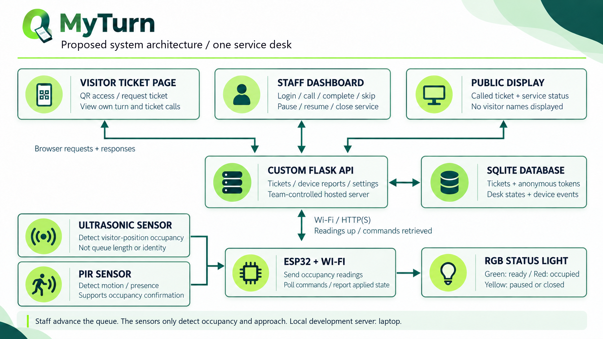

# MyTurn

## IoT Final Project Proposal

**Title:** MyTurn: Design and Implementation of an IoT-Based Queue Management and Service-Desk Status System
**Tagline:** Your Turn, Made Simple.
**Institution:** Institut d’Enseignement Supérieur de Ruhengeri (INES-Ruhengeri)
**Faculty:** Faculty of Sciences and Information Technology
**Department:** Computer Science
**Option:** Industrial Information Technology (IIT), Level III
**Module:** Internet of Things (IoT)
**Course lecturer:** Joselyne Byukusenge
**Supervisor:** ………………………………

**Prepared by**

1. NIYODUHORANA Leah, 25/27754
2. DUKUNDIMANA Odilla, 25/26987
3. Isaac MUSHIMIYIMANA, 24/25783

**Submission date:** Sunday 18 October 2026

> Plain-text mirror of `MyTurn_Project_Proposal.docx`. The DOCX is the version that
> is submitted; when one is edited, the other is regenerated from it.

## 1. Project Title

MyTurn: Design and Implementation of an IoT-Based Queue Management and Service-Desk Status System

The name MyTurn is short and easy to pronounce, and it sums up what the system does: it tells a visitor when their turn has come and whether the desk is open.

The prototype combines a numbered-ticket queue with sensor-based detection of the visitor position and of an approaching visitor, and a status light that staff control from a web page. It will serve one university service desk, such as registration or finance. If the demonstration uses a real office, the team will ask the responsible staff first.

## 2. Problem Statement

University service offices can receive several visitors at the same time. Where service depends on an informal line or on staff calling out names, a visitor may not know who is next, which ticket is being served, or whether the desk has paused. People then crowd around the desk, ask the same questions again, disagree about turns, and interrupt office work. Visitors without smartphones also need a way to join the same queue.

A light that only shows whether a desk is empty does not fix this on its own. An empty chair says nothing about whether staff are available, and it does not tell anyone who is next. The desk needs a ticket order that everyone can see, a status that staff control, and a signal showing that a visitor has reached the desk. The team has not measured queue lengths or waiting times at any office yet.

## 3. Project Objectives

### 3.1 Main Objective

To design, implement, and demonstrate a low-cost IoT prototype that organises visitors at one service desk and reports ticket calls, desk occupancy, visitor approach, and service status through a web application and a physical indicator.

### 3.2 Specific Objectives

- To build a ticket system that issues unique sequential numbers on a first-come, first-served basis and lets staff issue a ticket for a visitor who has no smartphone.

- To build a sensor circuit, using an ESP32 with an ultrasonic sensor and a passive infrared sensor, that detects occupancy at the service position and the approach of a visitor.

- To write a custom Flask API and SQLite database that receive device readings, store tickets, and exchange control commands, without using Blynk or ThingSpeak.

- To provide a public page for ticket and status information and a staff dashboard behind a login, so that staff can call, complete, skip, or cancel tickets and pause or resume service.

- To test occupancy detection, approach detection and walk-past rejection, ticket order, notification updates, remote light control, data persistence, and connection handling, and to record the results.

## 4. Proposed Solution

### 4.1 Visitor and Staff Workflow

A visitor scans a QR code, which opens the MyTurn visitor page, and requests a ticket. The server assigns the next number in the queue, for example, A012. Someone without a smartphone can ask a staff member for a ticket, and the number is written down or read out. Both kinds of ticket join the same queue.

The visitor page shows which ticket is being called, the visitor’s own number, how many tickets are ahead of them, and whether the desk is active, paused, or closed. A screen outside the office shows the called number and the desk status, with no visitor names. During the demonstration a laptop browser or a second phone will serve as that screen.

Staff sign in and press the Call next button to take the earliest waiting ticket. One ticket is active at a time, and staff mark it completed or skipped before calling the next. A skipped ticket leaves the queue; if that visitor comes back, staff issue a new ticket at the end. Cancelled tickets are never called. Pausing or closing service keeps the existing tickets and stops new calls; closing also stops new ticket requests.

### 4.2 Occupancy and Approach Detection, and Physical Indication

The HC-SR04 sensor will be mounted so that it watches the visitor position and not the whole waiting area. The ESP32 will compare the measured distance with a calibrated threshold and will need several consistent readings before it changes state, so that brief movement does not trigger a change. The distance sensor will show only whether the position is occupied. It will not identify anyone or count the queue.

A passive infrared sensor will sit beside it and watch the approach to the desk. It reacts to movement, so it cannot take over the measuring job: a visitor who stands still at the counter fades out of its view. Instead it will notice that someone is walking up, and that does two useful things. The device will take distance readings more often while an approach is in progress, so a visitor at the desk is confirmed sooner, and the dashboard will show a short approaching hint before the position is marked as occupied. If no occupancy reading follows an approach within about ten seconds, the event will be stored as a walk-past and the desk state will not change. The module needs about half a minute to settle after it is powered, so its output will be ignored during that warm-up and the approach state will read as unknown. Like the distance sensor, it will not identify anyone.

The status light will show three states:

- Green (Ready): service is on and no one is at the service position.

- Red (Occupied): service is on and someone is at the service position.

- Yellow (Paused or closed): staff have turned service off; this state overrides the other two.

Visitors come to the desk when their ticket is called, not whenever the light is green. Staff advance the queue; the sensors never do it on their own.

### 4.3 Communication, Processing, and Remote Control

The ESP32 will send occupancy readings and approach events, each with a timestamp, to the Flask API over Wi-Fi and will regularly ask the server for the current service setting. When staff pause or resume service, the server stores the new setting; the ESP32 collects it and changes the RGB LED. The dashboard will show both the setting that was sent and the last state the device reported, so that a command is never displayed as applied while the device is offline.

SQLite will hold tickets, ticket state changes, device reports, and desk settings. Ticket numbers and the next ticket will be chosen inside a database transaction, so that two simultaneous requests cannot receive the same number. The browser pages will refresh about every two seconds. The dashboard will show the time of the last device update and will mark occupancy as unknown when reports stop arriving. The ESP32 will retry a dropped connection and, if it has had no valid command for a short period, will switch to yellow instead of keeping a ready state.

For the final device-to-server demonstration, the team plans to use a server or cloud host that it controls, subject to hosting availability. During development, the server will run on a laptop, which will also serve as a clearly labelled fallback for the demonstration. Local testing may use HTTP, and a public deployment will use HTTPS with certificate checking. Device requests will carry a device key, staff actions will need a signed-in session, and forms will be protected against forged submissions. Credentials will not appear on public pages or in the QR code.

### 4.4 Visitor Notifications

When staff call a ticket, the public screen and the visitor’s open page will show the number. If time allows, the team will add a sound in the browser that the visitor turns on, or a buzzer on the device. The team will not promise alerts on a locked phone or a closed browser. SMS, WhatsApp, and push notifications are outside the scope of this version.

### 4.5 Innovation, Creativity, and Scope

MyTurn brings together four things that already exist on their own: anonymous tickets, a way for staff to issue a ticket without a smartphone, occupancy and approach sensing at the desk, and a light that staff control from the dashboard. Putting them in one small self-hosted system is the new part. Visitors should get a clearer idea of when their turn comes, and staff keep control of service decisions.

The first version covers one desk and first-come, first-served service. It will not cover multiple desks, priority queues, waiting-time forecasts, cameras, automatic crowd counting, or visitor identity. Charts and occupancy summaries will be added only if the main workflow works reliably first.

### 4.6 Development Methodology

The team will use an Agile approach built around a working prototype, in short cycles over a few days, without a full set of Scrum ceremonies. It will agree on a minimum feature set first, then build and test one part at a time: first the sensor circuits, then server communication and light control, then tickets and the browser pages. A short daily review will list what is finished, what comes next, and what is blocking progress. Test results will decide the next change. Hardware, backend, interface, and documentation work will be split between the available members, and documentation will be written as the work happens.

## 5. Required Devices and Materials

Table 1 lists the parts and the software the prototype needs, with the quantity and purpose of each item.

**Table 1: Required devices and materials for the MyTurn prototype**

| Item | Quantity | Purpose |

| --- | --- | --- |

| ESP32 development board | 1 | Reads the sensors, communicates over Wi-Fi, and controls the status light |

| HC-SR04 ultrasonic sensor | 1 | Detects occupancy at the designated visitor position |

| HC-SR501 passive infrared sensor | 1 | Detects a visitor approaching the desk, separately from the distance reading |

| RGB LED | 1 | Indicates ready, occupied, and paused or closed states |

| Current-limiting resistors (about 220 to 330 Ω) | 3 | Limit the current through the three LED colour channels |

| Voltage-divider resistors (about 1 kΩ and 1.8 kΩ) | 2 | Reduce the ultrasonic sensor’s 5 V Echo output to about 3.2 V for the ESP32 input |

| Breadboard | 1 | Holds and connects the prototype circuit during assembly and testing |

| Jumper wires | 1 set | Connect the circuit components |

| USB data cable | 1 | Connects the ESP32 to a computer for programming and power |

| Mounting materials and printed QR or ticket instructions | 1 set | Hold the sensors in position and guide visitors |

| Laptop with a suitable USB power output | 1 (existing) | Development, local server hosting, and demonstration display |

| Wi-Fi router or suitable hotspot | 1 (existing) | Connects the device, the server, and the browsers |

| Smartphone | At least 1 (existing) | Tests QR access and the visitor ticket page |

| Python, Flask, and SQLite | 1 setup | Provide the custom API, application logic, and persistent storage |

| Arduino IDE with ESP32 support | 1 setup | Used to write and upload the device firmware |

| HTML, CSS, JavaScript, and a modern browser | 1 setup | Provide the staff and public interfaces |

| Team-controlled server or cloud host | 1 deployment | Demonstrates communication with the project’s own hosted API |

The circuit will run on low-voltage power. The ultrasonic sensor will be supplied from the 5 V pin and its Echo output will go through a voltage divider instead of straight into the ESP32, while the infrared sensor will run from the same pin and its output will go straight to a free input, because it switches at 3.3 V. A buzzer and a separate large display are optional and are not in the budget. During local testing, every device that has to reach the server must use the laptop’s network address, because a QR code pointing at localhost will not open from a phone.

## 6. System Architecture

Figure 1 shows how the parts connect. Visitor browsers and the staff dashboard both talk to the same backend, and the ESP32 exchanges readings and commands with that backend. It does not talk to visitors’ phones directly.

*Figure 1: Proposed MyTurn system architecture for one service desk*

The main data flows will be as follows:

1. Visitor request: QR code → visitor page → Flask API → new ticket stored in SQLite.

2. Ticket call: staff dashboard → authenticated API action → updated ticket state → public display and open visitor page.

3. Occupancy report: ultrasonic sensor → ESP32 → Wi-Fi → API → SQLite → dashboard.

4. Approach report: passive infrared sensor → ESP32 → Wi-Fi → API → dashboard hint, closed as a walk-past if no occupancy reading follows.

5. Remote control: staff pause or resume action → API setting → ESP32 command polling → RGB LED → device-reported applied state.

The database will hold ticket numbers and their states, anonymous access tokens, event times, desk settings, and device readings. Joining the queue will not require a name, telephone number, photograph, or student registration number. Ticket links will use tokens that are hard to guess, and the public pages will show only what the public screen needs. Demonstration records will be kept only for testing and for the report.

## 7. Expected Results

The team expects to finish with a working one-desk prototype that issues and calls tickets in order, shows the desk status, detects occupancy and an approaching visitor, and changes a physical light from the dashboard. Clearer turn-taking is the aim. The team will not claim that waiting times fell or crowding eased unless it has measured them.

Table 2 lists the targets that the tests will check. These are targets, not results.

**Table 2: Planned acceptance criteria for evaluating the MyTurn prototype**

| Test area | Planned acceptance criterion |

| --- | --- |

| Occupancy detection | At least 18 correct classifications out of 20 labelled trials at the service position; any failures and the conditions that cause them will be reported |

| Approach detection | At least 9 of 10 approaches are reported within 2 seconds of the visitor entering the marked zone |

| Walk-past rejection | No occupancy state is recorded in 10 trials in which a person walks past the desk without stopping |

| Ticket allocation and order | Unique numbers and correct first-come, first-served selection for 20 test tickets, including simultaneous requests |

| Staff workflow | Completed, skipped, and cancelled tickets are excluded from the waiting selection, and no more than one ticket is active |

| Public and mobile notification | An open page shows a new ticket call within 5 seconds on a healthy connection |

| Remote light control | Pause and resume are reflected by the LED and confirmed by a device report within 5 seconds on a healthy connection |

| State priority | The paused or closed indication overrides occupancy in every tested combination |

| Persistence | Ticket records and queue order remain correct after an application restart |

| Connectivity | Device status becomes offline or unknown within 15 seconds without a valid update, and pending commands are not falsely shown as applied |

| Access control | Unauthenticated users cannot execute staff actions, and invalid device keys are rejected |

Testing will use people acting as visitors and states that the team labels by hand, including approaches that end at the desk and walk-pasts that do not. Expected and observed outcomes, response times, and any failures will be recorded. Photographs, screenshots, test tables, and charts from the actual data will go into the report. The final submission will include the prototype, the source code, the circuit and architecture diagrams, the report, and one slide deck.

## 8. Estimated Budget

Table 3 estimates the cost of the hardware, materials, and services the prototype needs, in Rwandan francs. The figures are planning estimates, not supplier quotations, and the team will confirm prices and availability before buying. The laptop, smartphone, and Wi-Fi device are already available.

**Table 3: Estimated budget for the MyTurn prototype (RWF)**

| Item | Quantity | Unit cost (RWF) | Total (RWF) |

| --- | --- | --- | --- |

| ESP32 development board | 1 | 15,000 | 15,000 |

| HC-SR04 ultrasonic sensor | 1 | 4,000 | 4,000 |

| HC-SR501 passive infrared sensor | 1 | 3,500 | 3,500 |

| RGB LED | 1 | 1,000 | 1,000 |

| Resistors, including the voltage divider | 5 | 100 | 500 |

| Breadboard | 1 | 4,000 | 4,000 |

| Jumper wires | 1 set | 3,000 | 3,000 |

| USB data cable | 1 | 2,500 | 2,500 |

| Mounting materials and printing | 1 allowance | 1,500 | 1,500 |

| Internet or mobile data | 1 allowance | 2,000 | 2,000 |

| Server or hosting | 1 short-term allowance | 5,000 | 5,000 |

| Subtotal |  |  | 42,000 |

| Contingency (10%) |  |  | 4,200 |

| Estimated total |  |  | 46,200 |

Existing parts or a free hosting tier may bring the cost down, but the team will not rely on either until both are confirmed. The hosting line is an allowance, not a commitment to a particular provider, and the contingency covers small price changes or an extra part. Free and open-source development software is used, so it has no cost line. Optional hardware such as a buzzer or a separate display is not included, and the budget will be revised if it is added.

## 9. Implementation Plan

Table 4 gives the stages and the date of each one, counted from the day the proposal is submitted. Independent tasks will run in parallel, and integration will not be left to the last day.

**Table 4: Implementation plan for the MyTurn project**

| Period | Planned activities | Main responsibility | Deliverable |

| --- | --- | --- | --- |

| Today
Sun 18 Oct | Agree on the scope, confirm components, assign roles, review the budget and architecture, and submit the proposal | Entire team; documentation lead | Reviewed proposal and agreed task list |

| Day 1
Mon 19 Oct | Wire and calibrate the distance sensor, the infrared sensor and the LED circuit, and create the database and basic API in parallel | Hardware and backend leads | Working local circuit and basic server |

| Day 2
Tue 20 Oct | Connect the ESP32 to the API, add device authentication, command polling, and remote light control, and build the ticket logic | Hardware and backend leads | End-to-end readings and control with persistent tickets |

| Day 3
Wed 21 Oct | Complete the public and staff pages, QR access, login, ticket actions, and notification polling, then run an integrated demonstration | Interface and backend leads | Complete minimum viable system |

| Day 4
Thu 22 Oct | Run the acceptance tests, fix priority defects, confirm the hosted demonstration, and finish the report and the slides | Entire team | Tested prototype, actual results, and the finished report |

| Presentation
Fri 23 Oct | Present the prototype and the report to the class, answer questions on the design, the tests and the results, and hand in the final files | Entire team | Final presentation and submitted deliverables |

The proposal is submitted today, Sunday 18 October 2026. Day 1 is Monday 19 October, Day 2 is Tuesday 20 October, Day 3 is Wednesday 21 October, and Day 4 is Thursday 22 October, when the build and the report are finished. The report and the prototype are handed in at the presentation on Friday 23 October 2026. The role labels will be replaced with the agreed names.

The risks are parts that cannot be found in time, false sensor readings, network problems, hosting trouble, and too little time to integrate everything. The team will buy or borrow the hardware early, keep the sensor mountings the same between tests, get the local data path working before trying a hosted one, and state limitations honestly. If hosting cannot be completed, the team will demonstrate the local version and say so instead of claiming the cloud deployment works. Tickets, communication, and remote control come before charts, sound, and appearance.
